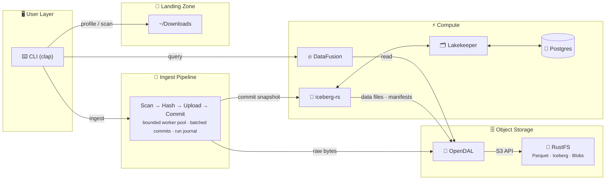
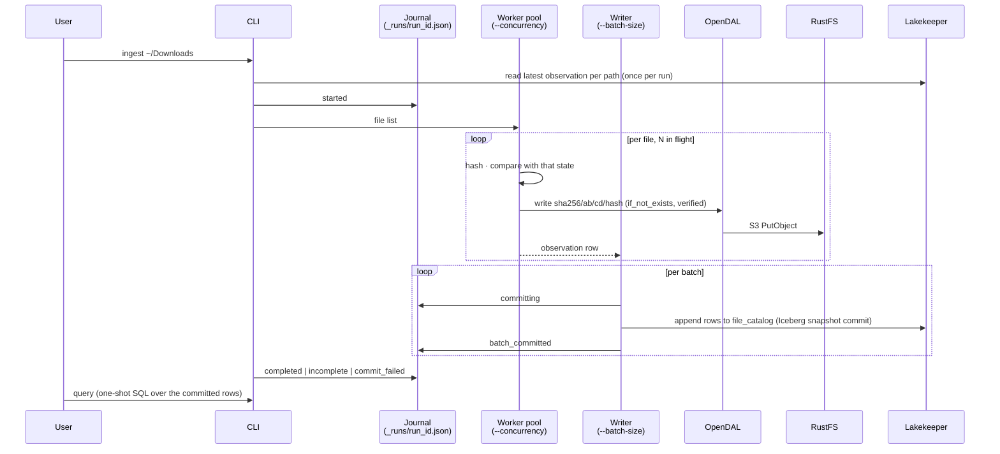

# Anti-Entropator Architecture

## Overview

Anti-Entropator is a **local data lakehouse** for file organization. It transforms a chaotic downloads folder into a queryable, organized data store using modern data engineering patterns.

## Architecture Diagram

Current state. Planned items are listed below the diagram and are not drawn.



> **Note:** There is one ingest engine with bounded stage concurrency (shipped
> in v0.3.0). `ingest` reuses the per-file inspection of `scan`; `scan` itself
> never enters the ingest pipeline. Per-stage tracing, a pipeline event
> schema, and an interactive SQL prompt are planned and not implemented. The
> dual-engine dataflow-rs plan was dropped
> ([ADR-007](../adr/ADR-007-dataflow-rs-orchestration.md), superseded 2026-09-17).
> All object-store I/O goes through OpenDAL
> ([ADR-006](../adr/ADR-006-opendal-unified-io.md)).
> This project is local-first; shared or public deployment requires additional security controls.
> [Roadmap v0.3.0](../ROADMAP-v0.3.0.md) is the closed record up to v0.3.

## Component Responsibilities

### CLI Layer

- **clap**: Command parsing and help generation
- **SQL REPL**: Planned for a future release. No implementation dependency chosen yet; `rustyline` was removed as a speculative dependency.

### Core Commands

- **profile**: Read-only directory analysis (no Docker needed)
- **doctor**: Verify stack health and external tools
- **init**: Initialize lakehouse (bucket, warehouse, Iceberg table)
- **up**: Verify lakehouse services are running
- **scan**: Enrich file metadata without uploading
- **ingest**: Upload to RustFS + commit to Iceberg via Lakekeeper
- **query**: Execute one-shot SQL via DataFusion
- **runs**: Inspect ingest run journals (`runs list`, `runs show <run_id>`)

Not in the binary (roadmap): interactive SQL, duplicate management workflow,
ingest branch merge, Iceberg maintenance.

### Pipeline Layer (v0.3.0)

- **Single engine, two bounded stages** (`src/ingest/pipeline.rs`): a
  `tokio::task::JoinSet` worker pool hashes, verifies, and uploads up to
  `--concurrency` files at once (default 4) and feeds a bounded `mpsc`
  channel; one writer task accumulates rows and commits every `--batch-size`
  rows (default 1000). Each batch is one Parquet file and one Iceberg
  snapshot. A failed commit stops the run: in-flight files finish, no new file
  starts, earlier batches stay committed, and the run exits non-zero with
  `status: commit_failed`. Batch success is not run atomicity. Peak memory
  holds the file list, the source's latest-observation map, and at most two
  batches of rows; file bytes are streamed, so memory scales with candidate
  count and history size, not file size.
- **Mutation-safe CAS upload** (`src/ingest/upload.rs`, ADR-009): a file is
  hashed once, written with OpenDAL `if_not_exists`, and re-hashed while
  streaming; if the bytes changed underneath, the write is aborted and the
  file is retried. An existing blob is reused only after its length and, where
  the store kept it, its recorded SHA-256 match the local file.
- **Run journal** (`src/ingest/journal.rs`): every writing run rewrites
  `_runs/<run_id>.json` in the data bucket on each transition (`started`,
  `committing`, `batch_committed`, then `completed`, `incomplete`, or
  `commit_failed`). An interrupted run leaves a non-terminal journal; the next
  run of the same source warns, counts the rows that run committed
  (`reconciled`), and marks it `superseded_by` when it completes.
- **Planned**: per-stage `tracing` spans and a pipeline event
  schema. There is no `--engine` flag; ADR-007's dataflow-rs second engine was
  [superseded](../adr/ADR-007-dataflow-rs-orchestration.md) because the crate
  is a JSONLogic rules engine, not a DAG executor.

### I/O Layer

- **OpenDAL**: Unified storage abstraction for all reads/writes/list/head/delete
- **object_store_opendal**: Adapter bridging DataFusion to OpenDAL (registered under `s3://`)
- **iceberg-storage-opendal**: OpenDAL-backed `FileIO` for Iceberg data and metadata files

### Storage Layer

- **RustFS**: S3-compatible object storage (replaces MinIO)
- **Parquet**: Columnar file format with ZSTD compression
- **Iceberg**: Table format. The CLI appends one snapshot per committed batch. It does not expose time travel and does not evolve a table's schema in place.

### Catalog Layer

- **Lakekeeper**: Apache Iceberg REST Catalog (no JVM)
- **Postgres**: Backend storage for Lakekeeper catalog state

## Data Flow

### Ingest Pipeline



> **Current state:** Blob and journal I/O goes through the OpenDAL `Operator`
> (`src/storage/mod.rs`). DataFusion reads via `object_store_opendal`. Iceberg
> data and metadata files go through `iceberg-storage-opendal`. Journal writes after `started` are best-effort and
> warn on failure; a failed `started` write refuses to start the run.

### Content-Addressed Storage

Files are stored with keys derived from their content hash:

```text
s3://<bucket>/
├── sha256/
│   ├── ab/
│   │   └── cd/
│   │       └── abcd1234...5678  (actual file bytes)
│   └── ef/
│       └── gh/
│           └── efgh9012...3456
└── _runs/
    └── <run_id>.json            (ingest run journal)
```

The key is `ContentHash::to_object_key()` (`src/domain/mod.rs`); Iceberg data
and metadata files live under the Lakekeeper warehouse prefix, not next to the
blobs.

Benefits:

- **Idempotent uploads**: Same file always gets same key
- **Natural deduplication**: Identical files share storage
- **Verifiable**: Key proves content integrity

## Configuration

The CLI has no config file. `--config` and `ANTI_ENTROPATOR_CONFIG` were removed
in v0.3 and the unused loader code was deleted afterwards. The commands that
reach the lakehouse (`up`, `init`, `ingest`, `query`, `runs`) use
`LakehouseConfig::default()` (`src/config/mod.rs`), which reads runtime
configuration from environment variables (see Environment Variables in the
manual). `doctor` reads the same variables. `profile` and `scan` need no
configuration. A config file or a `.env` loader would be a new decision.

## State

The Lakekeeper project ID is persisted to the platform data directory
(`~/.local/share/anti_entropator/lakehouse_state.json` on Linux,
`~/Library/Application Support/` on macOS). A legacy fallback reads
`.lakehouse_state.json` from the working directory if the platform path
does not exist.

## Error Handling

Current state:

- **Binary/CLI**: Uses `anyhow` for command orchestration and user-facing failures.
- **Library modules**: Return `anyhow::Result`. A typed error exists only where a caller matches on it: `NonUtf8Path`, `SourceChanged`, and `IntegrityMismatch`.
- **I/O safety**: Non-test code has no `.unwrap()`. The few `.expect()` calls state an invariant, not an I/O result.

## Safety Guarantees

1. **Local files are preserved**: Ingest copies into object storage and keeps source files in place.
2. **Dry-run support (current)**: `ingest --dry-run` checks the store and writes nothing; `ingest --dry-run --offline` needs no network. `scan` never writes; its `--dry-run` flag is accepted and has no effect. `init` has no dry-run.
3. **Snapshot commits**: Ingest writes are committed through Iceberg transactions.
4. **Local-first defaults**: Compose services bind to `127.0.0.1` and local development auth defaults are documented as non-production.
